# 스텝드라이브 실제 앱 시연

2026년 11월 7일, 제출용 APK `0.2.5-contest1`을 Pleos Connect 에뮬레이터에서 실행해 촬영했습니다. 앱 화면을 생성한 영상이 아니라 실제 실행 화면입니다. 차량 입력과 경로는 에뮬레이터의 Virtual Console 및 앱의 모의 내비를 사용했습니다.

**먼저 보기: [종합 시연 영상](videos/00_overview.mp4)**

GitHub에서 영상이 바로 재생되지 않으면 파일 화면의 다운로드 버튼 또는 `View raw`로 내려받아 재생하세요.

## 영상

| 파일 | 내용 | 음성 |
|---|---|---|
| [00 종합 시연](videos/00_overview.mp4) | 홈 → 코스 선택 → 방향 확인 경고 → 주행 음성 → 주차 → 결과 | 주행·주차 구간에 실제 앱 음성 포함 |
| [01 홈과 코스 선택](videos/01_home_course.mp4) | 열린 코스, 연습 코스 선택, 출발 준비 | 설명 자막 |
| [02 방향지시등 확인 경고](videos/02_direction_check.mp4) | 좌회전 안내 중 오른쪽 깜빡이를 켰을 때 표시되는 확인 경고 | 설명 자막 |
| [03 주행 중 음성 코칭](videos/03_voice_guidance.mp4) | 회전 준비 및 모의 사고 주의 구간 안내 | 실제 앱 음성 |
| [04 주차 음성 안내](videos/04_parking_voice.mp4) | 기본 후방 카메라 화면과 후진 속도·주차 확인 항목 안내 | 실제 앱 음성 |
| [05 주행 결과](videos/05_report.mp4) | 점수, 다음 연습 항목, 주차 점검 완료 | 설명 자막 |

영상은 기능별로 촬영한 두 세션의 장면을 편집했습니다. 대기 구간을 줄였고 설명 자막을 추가했습니다. 주행·주차 음성은 앱이 PC 스피커로 출력한 소리를 화면과 동시에 녹음한 것이며, 합성 해설을 덧붙이지 않았습니다. 녹음 음량은 재생 편의를 위해 보정했습니다.

## 화면 사진

아래 이미지는 실제 에뮬레이터 화면 캡처 또는 실제 녹화에서 추출한 프레임입니다.

| 화면 | 미리 보기 |
|---|---|
| 홈 · 연습 단계 | 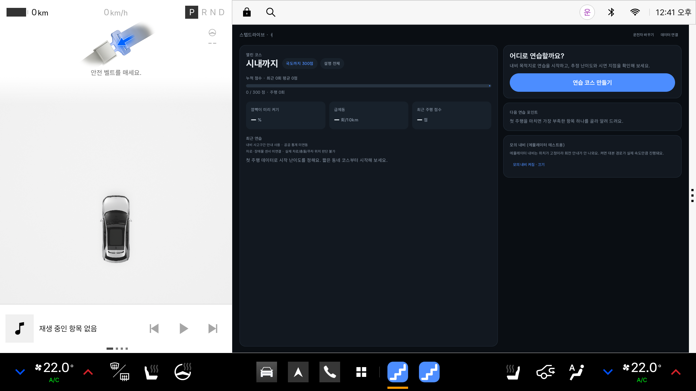 |
| 연습 코스 선택 | 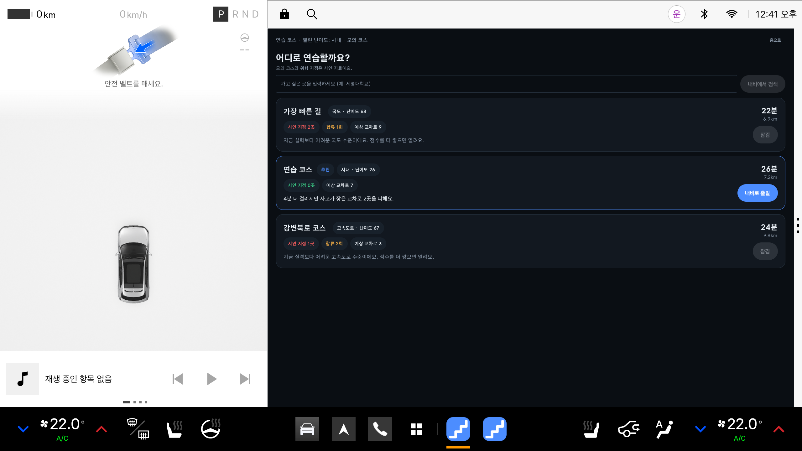 |
| 출발 준비 | 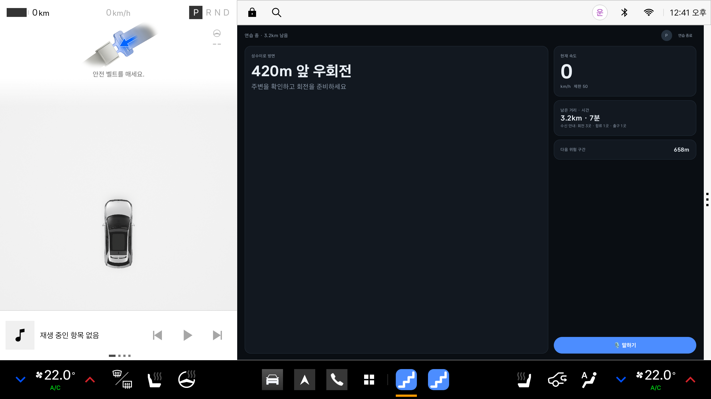 |
| 주행 중 간단 안내 | 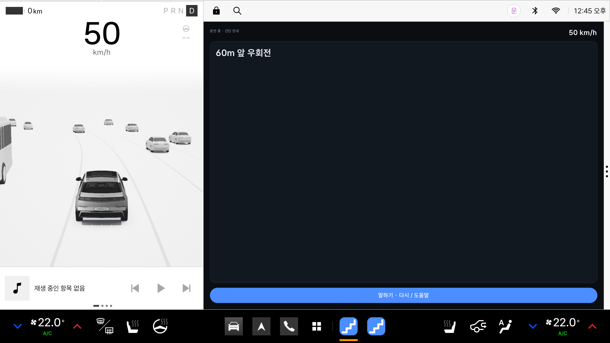 |
| 안내 방향과 깜빡이 불일치 | 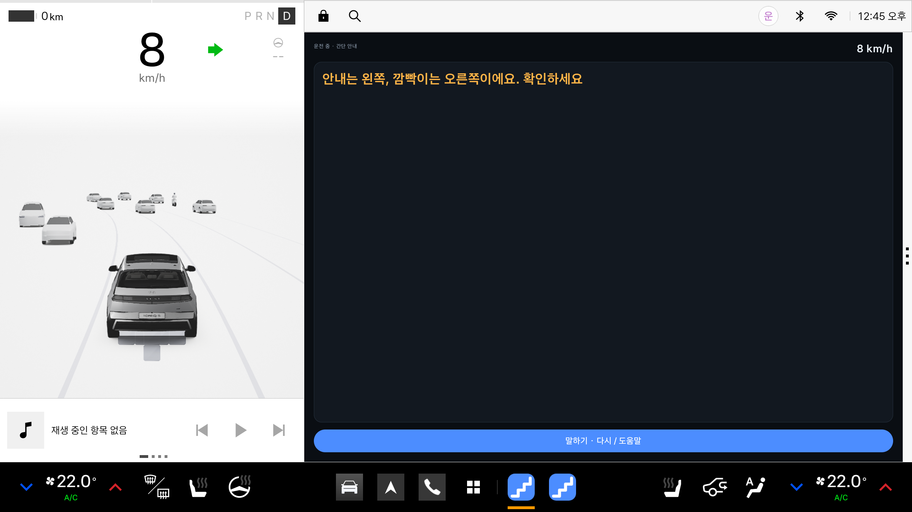 |
| 모의 위험구간 안내 | 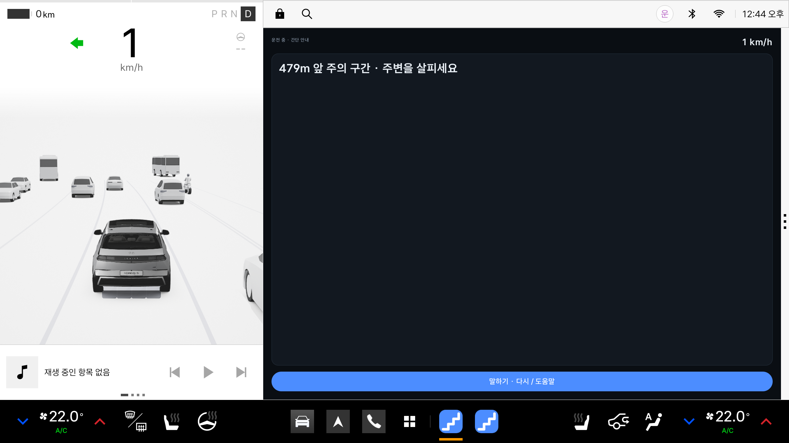 |
| 다음 회전 안내 | 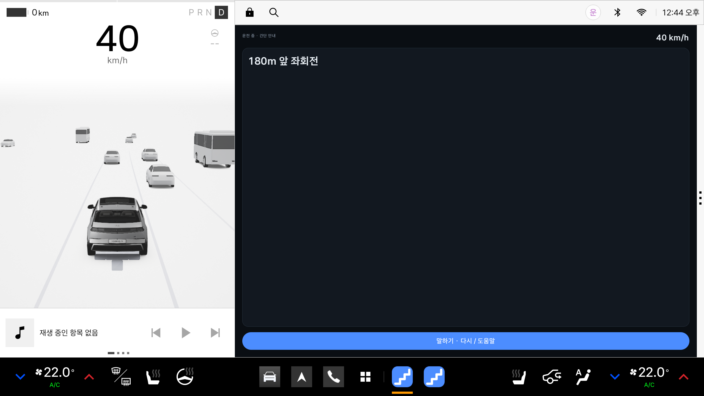 |
| 후진 시 차량 기본 카메라 | 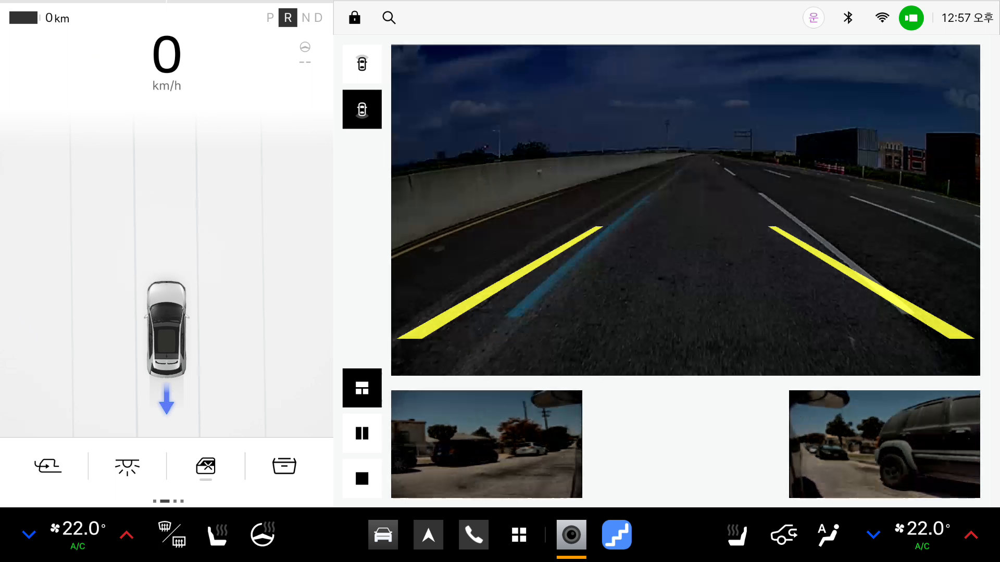 |
| 후진 속도 7km/h 입력 | 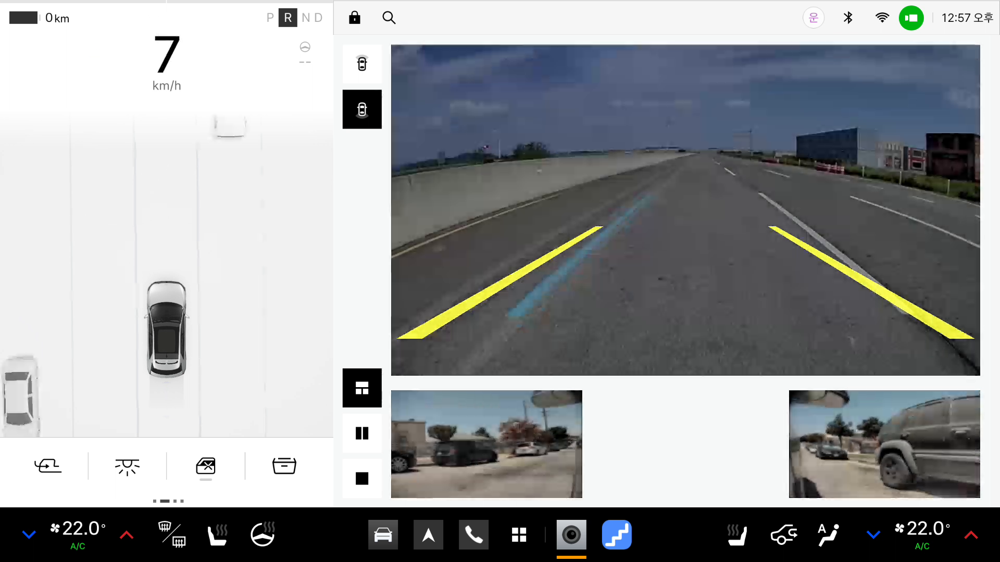 |
| 저속 후진 중 위치 확인 | 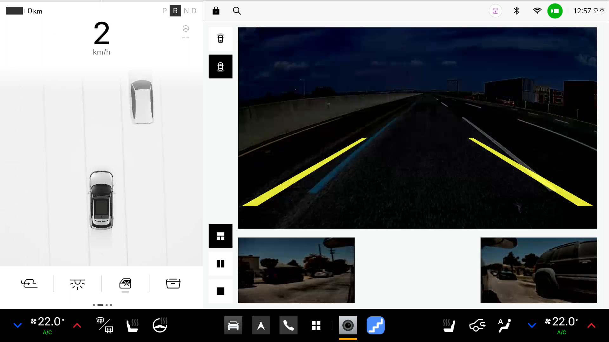 |
| 정지 후 주차 마무리 | 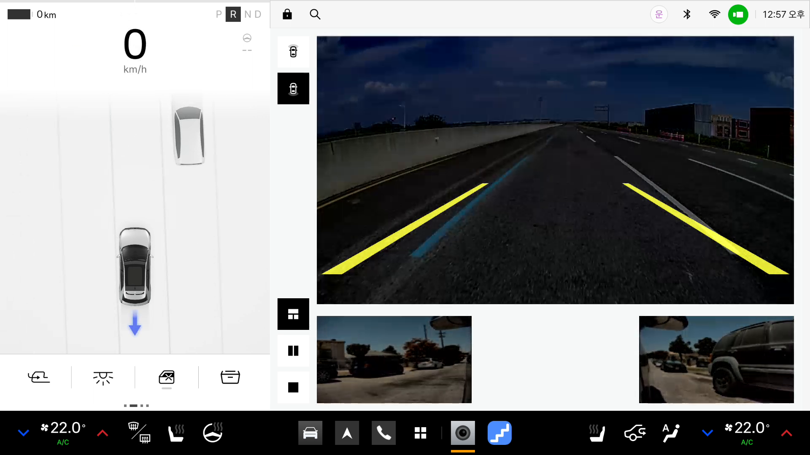 |
| 주행 결과 · 주차 점검 완료 | 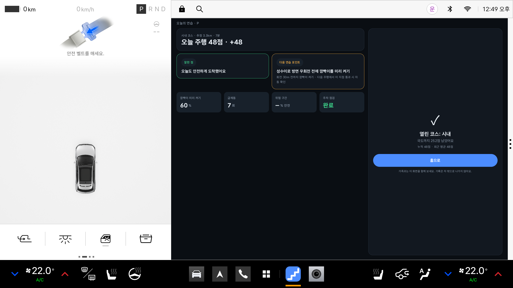 |
| 누적 기록 반영 후 홈 | 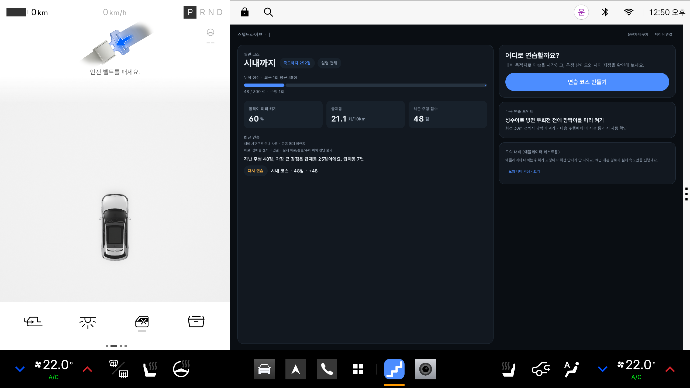 |

## 촬영 내용을 해석할 때

- 후진 중 표시되는 카메라 영상은 Pleos 에뮬레이터의 기본 차량 카메라입니다. 스텝드라이브가 카메라로 차선·장애물·주차 공간을 인식했다는 뜻은 아닙니다. 해당 장면에서는 앱의 음성 안내를 함께 확인하세요.
- 방향 확인 경고는 내비 안내 방향과 방향지시등 신호를 비교합니다. 실제로 어느 차선으로 이동했는지는 이 장면에서 판정하지 않습니다.
- 위험구간과 이동 경로는 모의 데이터입니다. 실차 주행이나 공공데이터 API 실연결을 촬영한 자료가 아닙니다.
- 결과 영상의 48점은 첫 번째 전체 모의 코스 촬영 결과입니다. 경고를 보여주기 위한 조작 실수와 계단식 속도 변경을 포함했으며, 실제 운전 실력을 검증한 수치는 아닙니다. 음성을 다시 촬영한 두 번째 세션의 결과와 구분했습니다.
- 기존 콘셉트 자료는 상위 `docs/screens/`, `docs/videos/`에 그대로 보존했습니다. 이번 실행 시연은 `docs/demo/`에 있습니다.

## 촬영 대상

- 앱: 스텝드라이브 제출
- 패키지: `kr.stepdrive.app.contest`
- 버전: `0.2.5-contest1` / versionCode `17`
- 환경: Pleos Connect 에뮬레이터 / Android 14(API 34)
- 제출 APK와 설치 APK SHA-256: `b3c3c26a7254a4b553bbbd69eab9fa78a89aca828d6e85568831435e38c86c76`
- 앱 소스와 제출 APK는 영상 제작 과정에서 변경하지 않았습니다.
